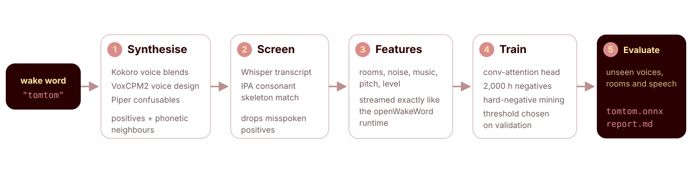

<p align="center">
  
</p>

<p align="center">
  <a href="https://yannikheizmann.github.io/wakesmith/"></a>
  <a href="https://github.com/yannikheizmann/wakesmith/actions/workflows/ci.yml"></a>
  <a href="pyproject.toml"></a>
  <a href="LICENSE"></a>
  
</p>

wakesmith trains a wake-word model for the word you choose, with one command. It creates
thousands of clips of people saying the word, keeps only the ones a speech recogniser
hears correctly, trains against 2,000 hours of background speech, and then reports how
the model holds up on voices, rooms and speech it has never heard. The result is a small
ONNX model that works in any [openWakeWord](https://github.com/dscripka/openWakeWord)
integration.

```bash
uv run wakesmith "tomtom"
```

## Why wakesmith?

The open-source recipes that exist today train on data the finished model never sees.
wakesmith fixes the three problems this causes:

- **It trains on what it will hear.** Other recipes process audio one way while training
  and another way while listening, so the model practises on data that looks nothing like
  the real world. wakesmith pushes every clip through the exact same openWakeWord feature
  pipeline your app uses.
- **Every clip really says the word.** Invented words are easy to mispronounce, and other
  recipes keep every synthetic clip, good or bad. wakesmith keeps a clip only when a
  speech recogniser actually hears the word in it.
- **You see honest numbers.** wakesmith counts false alarms per hour of real speech, mines
  hard negatives from all background speech, picks the detection threshold on validation
  data only, and grades the finished model on unseen voices, rooms, noise and speech. You
  know how good the model is before you deploy it.

<p align="center">
  
</p>

## Installation

wakesmith needs Linux on x86-64, an NVIDIA GPU with at least 16 GB of memory (24 GB for
the default settings), 32 GB of RAM and about 50 GB of disk. Everything else installs
itself with the project:

```bash
git clone https://github.com/yannikheizmann/wakesmith.git
cd wakesmith
uv sync --frozen
```

## Usage

```bash
uv run wakesmith "tomtom"                          # ~4 h on an RTX 4090
uv run wakesmith "tomtom" --config trial.yaml      # smaller datasets, ~30 min
uv run wakesmith "Computer" --language de          # German pronunciation and negatives
uv run wakesmith "nova" --negatives de -n "noah"  # English word, German households
```

The first run downloads about 30 GB of datasets and models into `~/.cache/wakesmith`;
after that everything is reused. Each run lives in its own folder under `wakesmith-runs/`
and continues where it stopped when you repeat the command. Every option can also be set
in a YAML file — the
[configuration guide](https://yannikheizmann.github.io/wakesmith/configuration/) includes
a small trial setup. The terminal shows live progress; detailed logs land in
`logs/<stage>.log`.

A finished run contains:

| File | Contents |
|---|---|
| `<word>.onnx` | the model, ready for openWakeWord |
| `<word>.json` | model card: recommended threshold and held-out results |
| `report.md` | a readable summary of the evaluation |
| `evaluation.json`, `training-log.json` | full measurements and training history |

Load it like any other openWakeWord model and alert on two consecutive frames above the
recommended threshold:

```python
from openwakeword.model import Model

model = Model(
    wakeword_models=["wakesmith-runs/tomtom-<hash>/tomtom.onnx"], inference_framework="onnx"
)
score = model.predict(frame)["tomtom"]  # frame: 1280 int16 samples at 16 kHz
```

## Languages

`--language` controls how the word is pronounced, checked and contrasted: pronunciation
guides, speech recognition, voice synthesis and look-alike words from that language's
60,000 most common words. Supported languages are English, German, Dutch, French, Spanish,
Italian, Portuguese and Polish. For non-English words, background speech in that language
is added automatically; `--negatives` adds more for any run.

## Documentation

The [documentation](https://yannikheizmann.github.io/wakesmith/) walks through every
stage, every option and the problems with the existing recipes.

## Tests

```bash
uv sync --frozen --extra dev
uv run --frozen pytest -q
```

## Contributing and security

See [`CONTRIBUTING.md`](CONTRIBUTING.md) for the development workflow and conventions.
Please report vulnerabilities as described in [`SECURITY.md`](SECURITY.md).

## Citation

If wakesmith helps your work, please cite it using [`CITATION.cff`](CITATION.cff).

## License

wakesmith is available under the Apache License 2.0. Models and datasets it downloads
keep their own licences; see [`NOTICE`](NOTICE).
